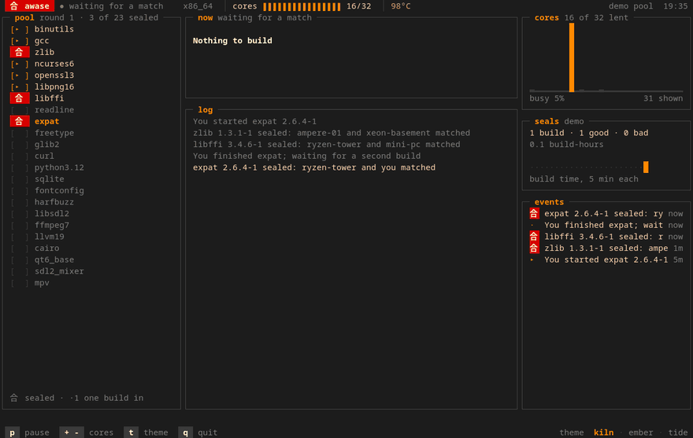

# Awase

**合わせ** *(awase)*: bringing two things together to see whether they match.

Awase is volunteer package building for [Renku OS](https://renkuos.org/). Volunteers lend their computers' idle time to build [RenkuOSPorts](https://github.com/RenkuOS/RenkuOSPorts) packages, like SETI@home or a mining pool. Every package is built twice and published only when both builds match.

It began as a proposal. Dru was building the [RenkuOSPorts portal](https://github.com/Druware/RenkuOSPorts-Portal), a public package repository and build coordinator for Renku OS, and the two-build check went into it (suggested in [portal issue #1](https://github.com/Druware/RenkuOSPorts-Portal/issues/1)). Awase is now a build client for the portal:

- **The portal, by Dru:** the repository website, the job queue and build clients, the two-build check (comparing package contents, since HaikuPorter writes file times into every package; a third build on a mismatch; admin approval for date-only differences), build priorities from the dependency graph, automatic updates, and a pkgman repository per platform.
- **Awase:** the two-build design, and two clients for the portal: a native app for Renku OS and `awase-tui` for Linux servers. They're in [client/](client/).
- **Still open:** signing. The proposal has clients sign their builds and a person sign the repository offline; the portal checks SHA-256s but signs nothing yet. Suggested in [portal issue #2](https://github.com/Druware/RenkuOSPorts-Portal/issues/2).

Both are being tested. The portal runs in Docker Compose, with a plan for Azure; Awase is tested against a stand-in that follows the portal's code (as of commit `56dde86`), not yet against the real server or with real HaikuPorter builds.

- **Website:** https://idumych.github.io/awase/
- **How it runs** (the pieces, a job's life, the two-build check, scheduling, the clients, deployment, and what changed from the proposal): https://idumych.github.io/awase/orchestration.html
- **The original proposal:** [PROPOSAL.md](PROPOSAL.md)



## The client

The Awase app for Renku OS and `awase-tui` share one core: the portal's build-client API, a build runner that can pause a build's whole process group, and the loop that claims a job, builds it, uploads the packages and reports back, or gives the job back when you quit. Building, testing and settings are in [client/README.md](client/README.md).

```
cd client
make test      # the pool's rules, then the client against a stand-in portal
make tui       # awase-tui (needs libcurl and ncursesw)
make           # the Renku app, on Renku OS (needs curl_devel)
```

## The site

Plain static HTML, CSS and JavaScript with no build step, in the style of the [Renku OS website draft](https://github.com/idumych/renkuos-website-draft). Open `index.html` or serve the folder.

```
index.html          the main page
orchestration.html  how the portal runs the pool
assets/style.css    all styles
assets/pool.js      the hero animation (packages sealed when two builds match) and the menu
assets/awase.svg    the seal, also the favicon
assets/logo.png     the Renku OS wordmark
PROPOSAL.md         the original proposal
```

## Licence

MIT. See [LICENSE](LICENSE).
