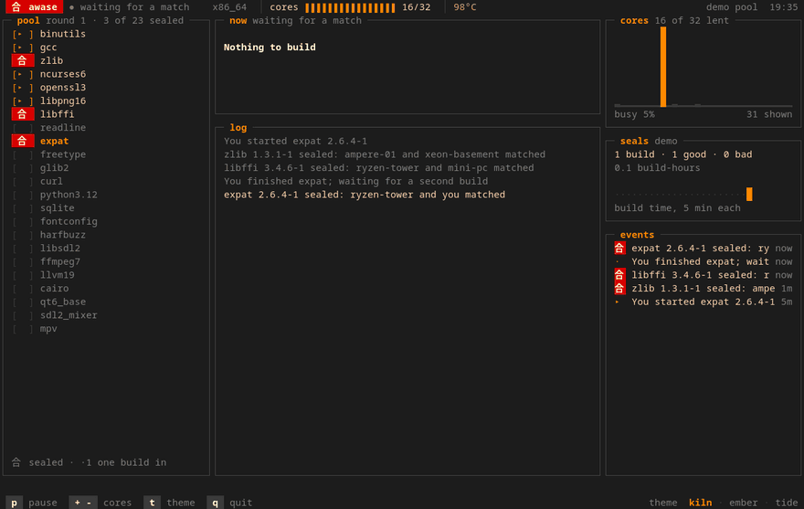

# Awase client

The app volunteers run: a native Be API app for Renku OS, in the Awase
ink-and-seal look. It builds for a **RenkuOSPorts coordinator**, the
portal at [Druware/RenkuOSPorts-Portal](https://github.com/Druware/RenkuOSPorts-Portal),
or shows a **simulated demo pool** of the two-build design, in which
nothing is built or uploaded.

## Building for a coordinator

Choose Pool › Coordinator… and enter the coordinator's address, this
machine's build client ID and secret (made on the coordinator's Clients
page; the secret is shown once), and a build command. Awase then does
what the portal's own client does, with the same build-command contract:

- claims the next queued job for its client's platform (the coordinator
  orders them by build priority, then age);
- runs `<build command> <port> <version> <outdir>` with
  `RENKUPORTS_PLATFORM`, `RENKUPORTS_JOB_ID` and `RENKUPORTS_RECIPE_PATH`
  set, `RENKUPORTS_PORTS_URL` and `RENKUPORTS_PORTS_REF` when the
  coordinator names the ports repository it builds from (as the portal's
  container clients get them), and `AWASE_CORES`, the cores you lend;
- uploads every `.hpkg` the command left in `<outdir>`, each with its
  SHA-256, then completes the build with the log, or fails the job with a
  reason. Packages of other ports (dependencies the build made on the way)
  are recorded by the coordinator but not published;
- on quit, stops a running build and gives the job back ("client
  stopped"), so it goes back to the queue at once without counting as a
  failure. A local problem (the work folder can't be made, the build
  command won't start) gives the job back too, and Awase waits before
  claiming again. A coordinator older than the release route gets a
  failure with "infrastructure: <reason>" instead.

Pause and "When idle" stop the build's whole process group and resume
it. The window shows the build's step (from HaikuPorter's messages,
roughly), its last log line, the time so far, and the coordinator's
published packages for the platform, with the ports this machine built
ringed.

The coordinator now does the two-build check itself: every job is built
twice and published only when both builds have the same contents, with a
different client preferred for the second build. A completed build is
therefore "built, to be checked against another build", not published
yet. A published package that two builds matched gets the 合 seal; one
published without (imported, older than the check, or approved by an
admin despite a difference) gets an empty frame.

`scripts/awase-mock-build.sh` is a stand-in build command that makes a
small fake package, for trying the whole path without building anything.
A real build command for Renku (HaikuPorter) is still to do.

The settings, including the client's secret, are kept in
`~/config/settings/Awase`, readable only by you.

## awase-tui: the terminal client for Linux servers



The same client for machines without a desktop, such as a VPS or a build
box reached over SSH: the same core (coordinator protocol, build runner,
live loop) in a tiled terminal layout, after the "Tiled" mockup.

- A top bar: what's building, the cores lent, the CPU temperature when the
  machine reports one, the coordinator and the time.
- The repository's published packages (合 when two builds matched, the
  ports this machine built in orange), the
  build with its steps and live log, the CPU use of every core, this
  machine's totals and build-time history, and the coordinator's events.
- One column on narrow terminals (80×24 works).
- Keys: `p` pause (the build's process group is stopped, not killed),
  `+`/`-` cores, `t` theme (kiln, ember, tide), `q` quit (asks first if a
  build is running, then gives its job back).
- `--plain` prints one timestamped line per event instead, for systemd and
  log files. `--demo` shows the simulated pool.

```
make tui                       # needs libcurl and ncursesw
./awase-tui --server https://ports.example.org --client-id <id> \
    --secret-file ~/.config/awase/secret --build-command <command>
```

Settings can live in `~/.config/awase/awase.conf` (see
`tui/awase.conf.example`). The secret comes from a file only you can read
(awase-tui refuses one that others can) or from `$AWASE_SECRET`.
`tui/awase-tui.service` runs `--plain` as a systemd user service, at low
CPU and I/O priority.

## The demo pool

The ports in dependency order, builds travelling from each simulated
volunteer's machine to the package, and the 合 seal landing when two
builds match; a mismatch flashes gold and the package is built again.
Hover a package or a machine for its details. Every volunteer and figure
in it is made up, and the window says so.

## Layout

```
core/        portable C++, no Haiku headers:
             Pool, DemoPool    the pool's rules and the demo
             Portal            the coordinator's build-client API (libcurl)
             Builder           runs a build command, pauses it
             LivePool          claim, build, upload, report or give back,
                               on a thread
             Json, Sha256
app/         the Be API app: the window, its hand-drawn views, and the
             Coordinator window
tui/         awase-tui, the terminal client for Linux (ncurses), with a
             systemd unit and an example config
scripts/     awase-mock-build.sh
tests/       core_test (the rules), live_test (against portal_stub.py,
             a stand-in for the portal's build-client API)
tools/       make-sysroot.sh (cross-building), make-icon.py (the icon)
```

## Building

On Renku OS: `make`. It needs libcurl's headers (`curl_devel`).

On Linux, cross-building for Renku x86_64 from a Renku build tree that
has built an image (it supplies the haiku and haiku_devel packages and
the host tools; the script fetches curl_devel):

```
sh tools/make-sysroot.sh ~/path/to/Source/generated.x86_64
. .sysroot-x86_64/env.sh
make HAIKU_CROSS=1
```

`make test` builds and runs the tests with the host compiler (it needs
libcurl and python3): the pool's rules, then the coordinator client
against `tests/portal_stub.py`, which follows the portal's
`BuildClientApi.cs` as of commit 56dde86: claiming builds, uploads staged
with their SHA-256 checked (a 409 for a different package of the same
name, other ports' packages as extras), the two-build check (one client
after its window, or two clients), failing, `/api/client/me`, the paged
package list, pausing a build, and stopping mid-build (the job given
back).

## Tested

- On the host: `make test`.
- In QEMU (x86_64, KVM) on a nightly image of RenkuOS/Source `main`: the
  demo pool, hovering, the sliders, When idle/Always, Pause/Resume,
  settings kept on quit, the icon in Tracker. From inside Renku against
  the stand-in server on the host: connecting through the Coordinator
  window, then four queued jobs, three built with the mock command,
  uploaded and published, and one failed and reported with its log.
- awase-tui on Linux (in alacritty at 150×42 and 80×24): the demo, all
  three themes, and against the stand-in coordinator: builds published, a
  failed build reported, the build's log followed live, a closed terminal
  and SIGTERM in `--plain` both reporting the running build as stopped,
  and a secret file readable by others refused.
- After the portal's two-build check (commit 56dde86): `make test`, and
  awase-tui `--plain` against the stand-in: two jobs each built twice and
  published, a dependency recorded as an extra, and a build stopped with
  the client going back to the queue. The Renku app was cross-built, not
  run again in QEMU.
- Not tested yet: the real portal server (it needs SQL Server and blob
  storage; the stand-in follows its code), a real HaikuPorter build, real
  hardware, the Linux build through Hokku.
