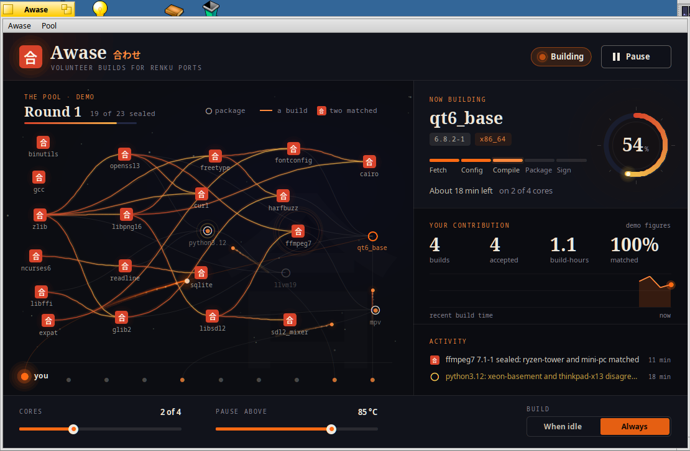
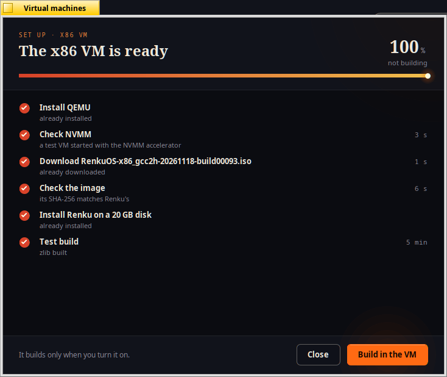
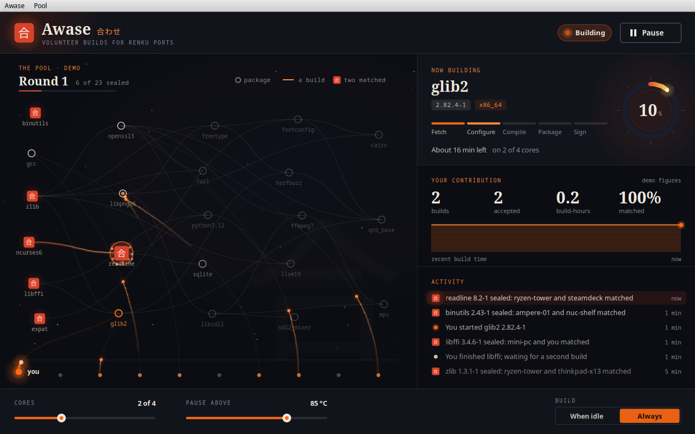

# Awase client

The app volunteers run: a native Be API app for Renku OS, in the Awase
ink-and-seal look. It builds for a **RenkuOSPorts coordinator**, the
portal at [Druware/RenkuOSPorts-Portal](https://github.com/Druware/RenkuOSPorts-Portal),
or shows a **simulated demo pool** of the two-build design, in which
nothing is built or uploaded.

Releases are for Renku OS: an x86_64 package (which installs on Haiku R1/beta6
too) and an arm64 one, on the
[releases page](https://github.com/idumych/awase/releases). The arm64 package
is the lite build: arm64 has no NVMM, so it has no x86 build VM (below). The
same source also builds for Linux as an AppImage (x86_64 and aarch64, through
[Hokku](https://github.com/idumych/hokku), a fork of Cosmoe) and for
VitruvianOS, a BeOS-like OS based on Linux (`.deb`, amd64 and arm64), but
those aren't released yet.

## Screenshots



The demo pool on Haiku R1/beta6.



The x86 build VM, set up and ready (Haiku R1/beta6 with NVMM, in QEMU).



The AppImage on Linux (aarch64, Wayland), as a seal lands on readline.

## Building for a coordinator

Choose Pool › Coordinator… and enter the coordinator's address, this
machine's build client ID and secret (made on the coordinator's Clients
page; the secret is shown once), and a build command. Awase then does
what the portal's own client does, with the same build-command contract:

- claims the next queued job for its client's platform (the coordinator
  orders them by build priority, then age);
- runs `<build command> <port> <version> <outdir>` with
  `RENKUPORTS_PLATFORM`, `RENKUPORTS_JOB_ID` and `RENKUPORTS_RECIPE_PATH`
  set, `RENKUPORTS_PORTS_URL` and `RENKUPORTS_PORTS_REF` when the
  coordinator names the ports repository it builds from (as the portal's
  container clients get them), and `AWASE_CORES`, the cores you lend;
- uploads every `.hpkg` the command left in `<outdir>`, each with its
  SHA-256, then completes the build with the log, or fails the job with a
  reason. Packages of other ports (dependencies the build made on the way)
  are recorded by the coordinator but not published;
- on quit, stops a running build and gives the job back ("client
  stopped"), so it goes back to the queue at once without counting as a
  failure. A local problem (the work folder can't be made, the build
  command won't start) gives the job back too, and Awase waits before
  claiming again. A coordinator older than the release route gets a
  failure with "infrastructure: <reason>" instead.

Pause and "When idle" stop the build's whole process group and resume
it. So does the temperature limit ("Pause above"): while the CPU is over
it, the build is stopped, and it carries on once the CPU is 5 °C under the
limit again. The reading is taken every 5 seconds and shown under the
slider, or "no sensor" when the machine has none Awase can read: on Renku
that's the acpi_thermal, pch_thermal and amd_thermal drivers'
`/dev/power` devices (the hottest counts); on Linux, a CPU thermal zone
or the k10temp, coretemp or zenpower sensor. Without a sensor the limit
does nothing. The window shows the build's step (from HaikuPorter's messages,
roughly), its last log line, the time so far, and the coordinator's
published packages for the platform, with the ports this machine built
ringed.

The coordinator now does the two-build check itself: every job is built
twice and published only when both builds have the same contents, with a
different client preferred for the second build. A completed build is
therefore "built, to be checked against another build", not published
yet. A published package that two builds matched gets the 合 seal; one
published without (imported, older than the check, or approved by an
admin despite a difference) gets an empty frame.

`scripts/awase-mock-build.sh` is a stand-in build command that makes a
small fake package, for trying the whole path without building anything.
A real build command for Renku (HaikuPorter) is still to do for this
machine's own builds; the x86 VM (below) builds with HaikuPorter.

The settings, including the client's secret, are kept in
`~/config/settings/Awase`, readable only by you.

## Building for x86 too, in a virtual machine

On a 64-bit x86 machine with NVMM (Haiku's hardware virtualization), the
Renku app can also build the pool's x86 jobs, in a Renku x86_gcc2h VM run
by QEMU. Choose Pool › Virtual machines… or the "Build x86 too" button. It
checks the machine first: 64-bit x86, NVMM, memory, free disk (the VM
takes 20 GB; BFS has no sparse files) and QEMU. Without NVMM it says why
(usually VT-x or AMD-V switched off in the firmware, or a VM without
nested virtualization) and sets nothing up: emulated, the VM would be far
too slow to build for the pool. NVMM runs only x86 code, so x86 is the
only architecture offered; arm64 and riscv64 aren't.

The VM needs its own build client on the coordinator, made for the x86
platform: its ID and secret go in the window. Setting up then takes six
steps, each with its progress:

1. **Install QEMU** from HaikuPorts with pkgman, if it isn't there.
2. **Check NVMM**: a VM is started for a moment with `-accel nvmm`.
3. **Download** tonight's Renku x86_gcc2h image and the nightly's
   x86_gcc2 repository (for `haiku_devel` at exactly the image's version,
   which HaikuPorter needs and Renku's online repository may not have
   yet), from Renku's GitHub nightly.
4. **Check the image**: both SHA-256s against Renku's.
5. **Install Renku on a 20 GB disk**, unattended, as Haiku's Installer
   does: Awase copies the image, mounts the copy and adds a one-time
   launch job. Booted, it formats the VM's disk, copies the system
   packages and settings (and `haiku_devel`), adds Awase's own SSH key,
   makes the disk bootable and powers off. The installed VM then boots,
   and Awase installs HaikuPorter in it over SSH.
6. **Test build**: zlib, with HaikuPorter, in the VM.

"Build in the VM" then boots it and runs a second coordinator client for
the x86 build client, whose build command builds the port in the VM with
HaikuPorter (from the ports repository the coordinator names) and copies
the packages back. The VM uses 4 cores and 3 GB of memory. It's paused
whenever building pauses (Pause, "When idle", the temperature limit), and
powered off on quit, its build given back. The window shows both machines:
"Now building" gets a ring each, the pool a "your VM" marker with its own
comet, and the activity both machines' events.

The VM and its files are in `~/config/non-packaged/data/Awase/vm`.

## awase-tui: the terminal client for Linux servers


The same client for machines without a desktop, such as a VPS or a build
box reached over SSH: the same core (coordinator protocol, build runner,
live loop) in a tiled terminal layout, after the "Tiled" mockup.

- A top bar: what's building, the cores lent, the CPU temperature when the
  machine reports one, the coordinator and the time.
- The repository's published packages (合 when two builds matched, the
  ports this machine built in orange), the
  build with its steps and live log, the CPU use of every core, this
  machine's totals and build-time history, and the coordinator's events.
- One column on narrow terminals (80×24 works).
- Builds pause while the CPU is over `--max-temp` (85 °C by default) and
  carry on once it's 5 °C cooler, as in the app.
- Keys: `p` pause (the build's process group is stopped, not killed),
  `+`/`-` cores, `t` theme (kiln, ember, tide), `q` quit (asks first if a
  build is running, then gives its job back).
- `--plain` prints one timestamped line per event instead, for systemd and
  log files. `--demo` shows the simulated pool.

Ready-made static binaries for Linux, one for each platform the portal
builds for (x86, x86_64, arm64, riscv64), are on the
[releases page](https://github.com/idumych/awase/releases). They need no
libraries and run on any distribution:

```
tar xzf awase-tui-0.2.0-linux-x86_64.tar.gz
cd awase-tui-0.2.0-linux-x86_64
./awase-tui --demo
```

Or build it yourself:

```
make tui                       # needs libcurl and ncursesw
./awase-tui --server https://ports.example.org --client-id <id> \
    --secret-file ~/.config/awase/secret --build-command <command>
```

Settings can live in `~/.config/awase/awase.conf` (see
`tui/awase.conf.example`). The secret comes from a file only you can read
(awase-tui refuses one that others can) or from `$AWASE_SECRET`.
`tui/awase-tui.service` runs `--plain` as a systemd user service, at low
CPU and I/O priority.

## The demo pool

The ports in dependency order, builds travelling from each simulated
volunteer's machine to the package, and the 合 seal landing when two
builds match; a mismatch flashes gold and the package is built again.
Hover a package or a machine for its details. Every volunteer and figure
in it is made up, and the window says so.

## Layout

```
core/        portable C++, no Haiku headers:
             Pool, DemoPool    the pool's rules and the demo
             Portal            the coordinator's build-client API (libcurl)
             Builder           runs a build command, pauses it
             Thermal           the CPU's temperature (Renku, Linux)
             LivePool          claim, build, upload, report or give back,
                               on a thread
             VmHost, VmSetup,  the x86 build VM: the machine's checks, the
             VmRunner,         six-step setup, running it in QEMU with
             VmService         NVMM, and building in it as a second client
             Download          HTTPS downloads with progress
             Json, Sha256
app/         the Be API app: the window, its hand-drawn views, the
             Coordinator window and the Virtual machines window
tui/         awase-tui, the terminal client for Linux (ncurses), with a
             systemd unit and an example config
scripts/     awase-mock-build.sh
tests/       core_test (the rules), live_test (against portal_stub.py,
             a stand-in for the portal's build-client API), vm_test (the
             VM setup against a fake release, QEMU and ssh)
tools/       make-sysroot.sh (cross-building), make-icon.py (the icon),
             release-tui.sh and alpine-sysroot.py (the Linux release)
```

## Building

On Renku OS: `make`. It needs libcurl's headers (`curl_devel`).

On Linux, cross-building for Renku x86_64 from a Renku build tree that
has built an image (it supplies the haiku and haiku_devel packages and
the host tools; the script fetches curl_devel):

```
sh tools/make-sysroot.sh ~/path/to/Source/generated.x86_64
. .sysroot-x86_64/env.sh
make HAIKU_CROSS=1
```

The Linux release, `sh tools/release-tui.sh 0.2.0`, cross-compiles a
static awase-tui for x86, x86_64, arm64 and riscv64 on any Linux host with
clang, lld and python3. It unpacks Alpine's musl, OpenSSL, zlib and
ncurses packages as sysroots (as plain archives; nothing from them is run)
and builds libcurl itself with HTTP and HTTPS only, then writes
`dist/tui-<version>/awase-tui-<version>-linux-<arch>.tar.gz` and `SHA256SUMS`. The
binaries find CA certificates and terminfo where the common distributions
keep them (`SSL_CERT_FILE` and `TERMINFO_DIRS` override).

`make test` builds and runs the tests with the host compiler (it needs
libcurl and python3): the pool's rules, then the coordinator client
against `tests/portal_stub.py`, which follows the portal's
`BuildClientApi.cs` as of commit 4d4d2be: claiming builds, uploads staged
with their SHA-256 checked (a 409 for a different package of the same
name, other ports' packages as extras), the two-build check (one client
after its window, or two clients), failing, `/api/client/me`, the paged
package list, pausing a build, and stopping mid-build (the job given
back).

## Tested

- On the host: `make test`.
- In QEMU (x86_64, KVM) on a nightly image of RenkuOS/Source `main`: the
  demo pool, hovering, the sliders, When idle/Always, Pause/Resume,
  settings kept on quit, the icon in Tracker. From inside Renku against
  the stand-in server on the host: connecting through the Coordinator
  window, then four queued jobs, three built with the mock command,
  uploaded and published, and one failed and reported with its log.
- awase-tui on Linux (in alacritty at 150×42 and 80×24): the demo, all
  three themes, and against the stand-in coordinator: builds published, a
  failed build reported, the build's log followed live, a closed terminal
  and SIGTERM in `--plain` both reporting the running build as stopped,
  and a secret file readable by others refused.
- After the portal's two-build check (commit 56dde86): `make test`, and
  awase-tui `--plain` against the stand-in: two jobs each built twice and
  published, a dependency recorded as an extra, and a build stopped with
  the client going back to the queue. The Renku app was cross-built, not
  run again in QEMU.
- The temperature limit: `make test` with a stand-in sensor (pausing over
  the limit, staying paused until 5 °C under it, a raised limit taking
  effect), and the Linux reading on a laptop (its `TCPU_PCI` zone). The
  Renku reading was cross-built only: QEMU has no thermal sensor, and it
  hasn't run on Renku hardware yet.
- The 0.2.0 Linux release: each of the four static binaries (arm64 and
  riscv64 under qemu-user) built a job against the stand-in in `--plain`,
  twice, to Succeeded; the full-screen demo drew in a pseudo-terminal;
  HTTPS reached a real site and refused a self-signed certificate. Not
  yet run on real arm64, riscv64 or 32-bit x86 hardware.
- Not tested yet: the real portal server (it needs SQL Server and blob
  storage; the stand-in follows its code), a real HaikuPorter build, real
  hardware, the Linux build through Hokku.
